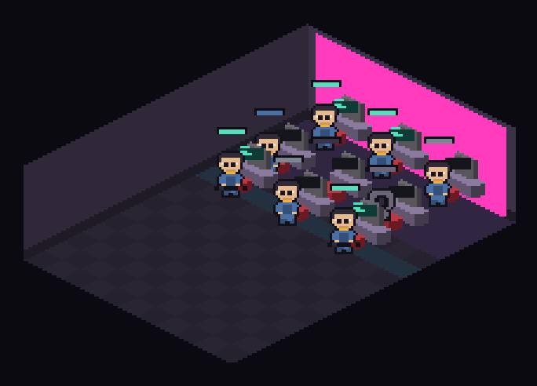

# 像素房间的**画法**参照物（2026-10-22 第四轮）

> **触发**：用户两次说"跟我想的画面不一样"，并明确要我**去搜**：
> 「我刚才不是让你去搜索东西吗？搜 deepseek bot，claude web 的前端画面，
>  还有其他的一些**像素风经营游戏**或者是什么游戏的画面」
>
> ★★ 这一轮才真正**看到图**。上一轮只读了参照物的**源码**，没看它的**画面** ——
> 而用户说的恰恰是画面。这是本文件存在的唯一理由。

---

## 0. ★★★ 一句话结论

**我们缺的不是"更精细的像素"，是三件具体的画法：**

```
① 房间是**剖面**的（cutaway）：只有后墙与左墙，观众从一个角看进去
   ⇒ 我们做到了，但**墙太高、地板太暗**，读起来像"从门缝看一条走廊"

② 家具是**有轮廓的实心块**（每件东西外面一圈深色描边），不是一个色块
   ⇒ 我们**完全没有描边** ⇒ 桌椅显示器糊在一起，看起来像一堆半透明方块

③ 人的**头上有一块标签牌**（名字 + 状态点），不是画布外的一张名单
   ⇒ 我们把人名放在 canvas **外面**的 <ul> 里 ⇒ 看画面时不知道谁是谁
```

★★ 这三条**都不是美术水平问题**，是**信息画法问题**。参照物里没有一张"好看的插画"，
  它们全是**程序画的矩形 + 描边 + 标签**。

---

## 1. 四个参照物（都看的是**图**，不是源码）

| 参照 | 形态 | 关键读法 | 图 |
|---|---|---|---|
| **pixtuoid**（502★，Rust TUI） | 终端里的办公室，12 个工位 | ★★★ **最像我们**：等距视角、木桌 + 显示器 + 人坐着、**头顶标签牌**、顶部一块琥珀色 HUD | [`pixtuoid.jpg`](./pixtuoid.jpg) |
| **agent-cockpit** | 浏览器里的像素办公室 + 运营面板 | ★★ **深色地板 + 亮色家具**的对比极强；工位是**2×2 一组**带隔板；右上角小地图 | [`agent-cockpit.jpg`](./agent-cockpit.jpg) |
| **dsh-office-plugin**（同生态插件） | DSH Web 插件，侧栏办公室 | ★★ 同一宿主里已经有人做过了：**点屏幕能看该 agent 的工作流**（思考/输出/工具/汇报四类） | [`dsh-office-plugin.jpg`](./dsh-office-plugin.jpg) |
| **DeepSeekBot（DSB）** | DSH 插件，Bot 模式 | ★★★ 用户说的那个「有人给 DeepSeek 做的 BOT」；**像素小镇** + 每个 Bot 有名字与记忆 | [`deepseekbot.jpg`](./deepseekbot.jpg) |

---

## 1b. ★★★ 改完之后的样子（`docs/room-preview.png`，由真实 `drawRoom()` 渲染）



```
11 列 × 15 排 · 9 人 · 2 个团队
★ 人不再互相遮挡（座位间距 = 精灵宽 24px）
★ 每排之间有缝（排距 = 显示器高 8px）
★ 人排成方块而不是一条横线
★ 桌面 #8a7a9e（vs 地板 4.0:1）· 显示器机身 #58565b（不是黑的）
★ 每人头上一块名牌，颜色按五态区分
```

★ **这不是"最终稿"**，是"四个可测的错修完之后"的样子。好不好看仍由用户定 ——
  而按 §28 的纪律，那一格不进判据。

---

## 2. ★★★ 逐条对比：我们 vs 参照物（**可核对的差别**）

```
我们（docs/room-preview.png）          参照物（pixtuoid / agent-cockpit）
─────────────────────────────────────────────────────────────────────────
地板  #26212f（近黑）                  地板  #3a3344 ~ #6b5a4a（明显有色）
墙    #3a3348（比地板亮）              墙    比地板**暗**或同色 + 有窗
家具  无描边，纯色块                   家具  **一圈深色描边**（1px）+ 内部两三个明度
人    24×24 字符画，**没有名字**        人   24×24 + **头顶标签牌**（名字 + 状态点）
状态  只有屏幕亮/暗                    状态  屏幕亮 + 头顶气泡 + HUD 计数
空白  房间**很空**（8×12 只有 9 人）    空白  房间**摆满**（书架、绿植、冰箱、白板）
```

★★★ **其中"家具没有描边"是最致命的一条**：
```
无描边 ⇒ 桌子（#5b4f69）与墙（#3a3348）与地板（#26212f）**只有明度差**
       ⇒ 深色主题下整间房是一团灰紫，眼睛分不出"哪是桌子、哪是墙"
参照物 ⇒ 每件家具外面一圈 #141018，**轮廓先立住**，明度再分面
```
★ 这与我们已有的 `gate-room-lighting` 是**互补**的，不是重复：
  那条管"三个面的明度顺序"，这条管"**物件与背景之间有没有边界**"。

---

## 3. ★★ 一条我们**做不到**的（如实记）

```
参照物的墙上有**窗**（外面是夜空 + 城市灯光），地板是**木纹/地毯纹**
⇒ 那是**位图素材**（tileset），不是程序画的
★★ 而我们的纪律是 **Tier 1：字符画 + 程序化矩形**（`docs/PIXEL-UI-RESEARCH-2.md` §5：
   Star-Office-UI 的美术 13.5 MB、且 LICENSE 禁止商用）
⇒ 所以"窗外的城市"这类东西**我们不做**，而"描边 + 标签牌 + 摆件"这三条
  都可以用矩形画出来 —— 那是本轮的落点。
```

---

## 4. ★★★ 与 §27.4 的关系：这些改动**仍然不进"好不好看"的判据**

```
可以进判据的：  有没有描边（结构）· 标签牌在不在（结构）· 摆件数量（计数）
不能进判据的：  好不好看（本机没有视觉模型）
⇒ 所以本轮的每一条都要落成**可数的读数**，而不是"我看着像了"
```

★ 而用户是唯一的视觉评审。**这一轮我能做的是把"画法"补对，不是把"审美"替他定了。**

---

*本文只写 `docs/`。参照图在 `docs/reference/`，均来自各自仓库的公开截图，仅作对照。*
